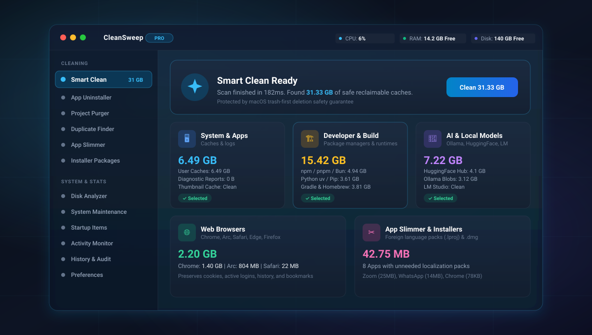
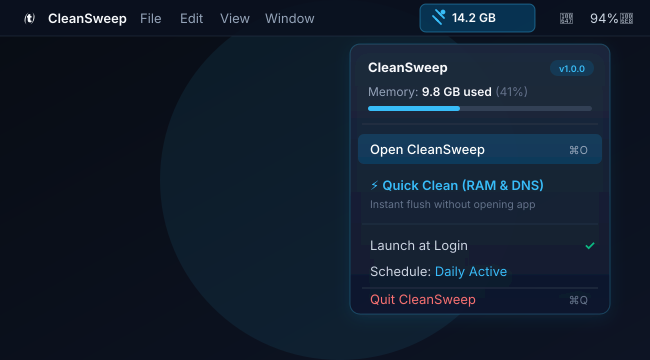
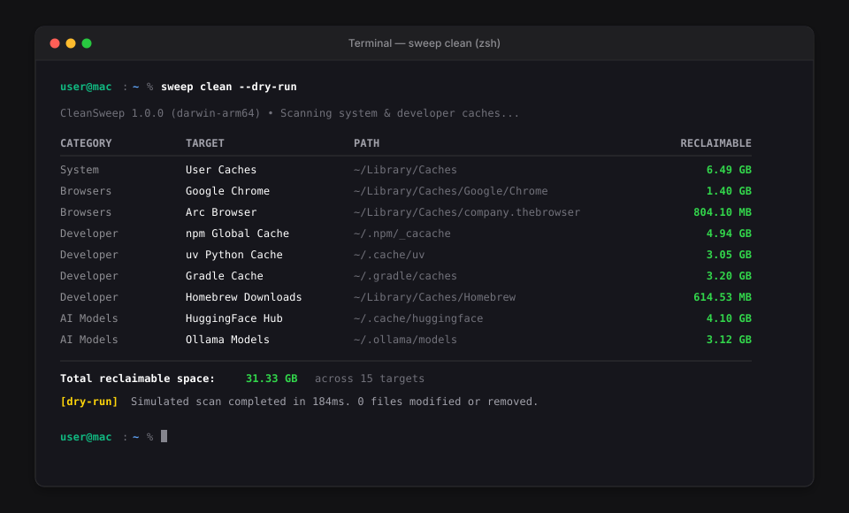

<p align="center">
  
</p>

<h1 align="center">CleanSweep</h1>

<p align="center">
  A fast, zero-telemetry disk cleaner, application uninstaller, and system optimizer for macOS.
</p>

<p align="center">
  <a href="https://github.com/thecodekaizen/CleanSweep/actions/workflows/ci.yml">
    
  </a>
  <a href="https://github.com/thecodekaizen/CleanSweep/blob/main/LICENSE">
    
  </a>
  
  
</p>

<p align="center">
  <a href="#installation">Installation</a> •
  <a href="#overview">Overview</a> •
  <a href="#features">Features</a> •
  <a href="#cli-usage">CLI Usage</a> •
  <a href="#menu-bar-companion">Menu Bar</a> •
  <a href="#comparison">Comparison</a> •
  <a href="#safety">Safety</a>
</p>

---

## Overview

<p align="center">
  
</p>

CleanSweep is a native macOS application and command-line utility built for developers and Mac power users. It combines deep cache cleaning across developer toolchains, safe residue-free app uninstallation, and system maintenance routines without background trackers, subscriptions, or analytics.

### Design Principles

- **Zero Telemetry**: Completely offline. No analytics, tracking pixels, crash telemetry, or network calls.
- **Trash-First Deletion**: All deletions route through the native macOS Trash (`shell.trashItem`). Items can be restored instantly via Finder.
- **Developer Stack Support**: Built-in awareness of Xcode caches, package manager stores (`npm`, `pnpm`, `uv`, `cargo`, `pip`), Docker virtual disks, and local AI model stores (`ollama`, `huggingface`).
- **Dual Interface**: A clean macOS native dark/light desktop app paired with a lightweight terminal companion (`sweep`).

---

## Installation

### Terminal CLI (`sweep`)

Install the `sweep` CLI globally via the official install script:

```bash
curl -fsSL https://raw.githubusercontent.com/thecodekaizen/CleanSweep/main/install.sh | bash
```

Run the interactive terminal interface:
```bash
sweep
```

### Desktop Application

Download the precompiled `CleanSweep-1.0.0-arm64-mac.zip` from [GitHub Releases](https://github.com/thecodekaizen/CleanSweep/releases), unpack it, and drag `CleanSweep.app` into `/Applications`.

---

## Features

### Smart Cache Cleaner
Scans over 25 high-volume cache locations across macOS:
- **System & User Caches**: Application caches (`~/Library/Caches`), diagnostic reports, spindumps, and QuickLook thumbnail databases.
- **Browsers**: Cache, media, and script storage for Google Chrome, Arc, Safari, Brave, Edge, and Firefox without wiping logins, history, or cookies.
- **Developer Stores**:
  - Xcode: `DerivedData`, iOS DeviceSupport symbols, archives, and simulator caches.
  - Package Managers: `npm` (`_cacache`), `pnpm` store, `yarn`, `bun`, `cocoapods`, and Homebrew download caches.
  - Languages: `uv` and `pip` wheels, Cargo registry and git checkouts, Go build cache, and Gradle daemons.
  - IDEs: VS Code extension caches and JetBrains project caches.
- **Local AI Models**: Downloaded weights and checkpoints from Ollama (`~/.ollama/models`), HuggingFace Hub (`~/.cache/huggingface`), and LM Studio.
- **Virtualization & Containers**: Reclaimable Docker virtual disks (`Docker.raw`) and Podman machine storage.

### Application Uninstaller & Orphan Finder
- **Application Explorer**: Scans `/Applications` and `~/Applications` with bundle IDs, versions, and true on-disk footprint.
- **Residual Leftover Discovery**: Detects associated files scattered across `~/Library/Application Support`, `~/Library/Caches`, `~/Library/Preferences`, `~/Library/Containers`, and `~/Library/Saved Application State`.
- **Orphan Finder**: Identifies leftover preferences and support files left behind by applications previously deleted through Finder.

### Project Build Artifact Purger (`sweep purge`)
Recursively discovers rebuildable project build directories across your workspace:
- `node_modules` (JavaScript / TypeScript)
- `.next`, `.nuxt`, `.svelte-kit` (Frontend builds)
- `target` (Rust Cargo)
- `.venv`, `venv`, `__pycache__` (Python)
- `.gradle`, `.dart_tool`, `.turbo`, `dist`, `build`

### Duplicate File Finder (`sweep duplicates`)
- Two-pass duplicate finder:
  - Pass 1: Size grouping and fast initial 64KB chunk verification.
  - Pass 2: Full SHA-256 cryptographic hash comparison.
- Automatically keeps the oldest original file and targets redundant duplicates for safe removal.

### Localization Slimmer (`sweep slim`)
- Scans installed macOS application bundles for foreign `.lproj` language packages.
- Strips unneeded languages while preserving your active system language and English.

### Installer Package Cleaner (`sweep installer`)
- Scans `Downloads` and `Desktop` for forgotten `.dmg`, `.pkg`, and `.iso` installation files.
- Safe batch cleanup to recover space once apps are installed.

### Large & Old Files Explorer (`sweep large`)
- Identifies multi-gigabyte or aged files across `Downloads`, `Documents`, `Desktop`, `Movies`, and `Music`.
- Filter by size (`>50MB`, `>500MB`, `>1GB`) and age (`>30d`, `>90d`, `>1y`).
- Categorized into Archives, Disk Images, Media, and Documents with one-click Reveal in Finder.

### System Maintenance Utilities (`sweep optimize`)
- **Flush DNS Cache**: Flushes system resolver cache and signals `mDNSResponder`.
- **Purge Inactive Memory**: Triggers macOS memory pressure release to return inactive disk cache to the free memory pool.
- **Rebuild LaunchServices**: Fixes duplicate "Open With" contextual menu entries and broken file associations.
- **Reset QuickLook**: Clears preview thumbnail caches and restarts the QuickLook daemon.
- **APFS Snapshot Trimming**: Inspects and prunes stale local Time Machine snapshots taking up SSD blocks.
- **Touch ID for Sudo Check**: Verifies biometric PAM configuration in `/etc/pam.d/sudo_local`.

### Automated Background Scheduler
- Schedules automatic background cleanups on a **Daily** or **Weekly** interval.
- Configures a native macOS `LaunchAgent` daemon (`~/Library/LaunchAgents/com.thecodekaizen.cleansweep.autoclean.plist`).
- Configurable via the GUI Preferences or terminal: `sweep schedule daily`, `sweep schedule weekly`, or `sweep schedule off`.

---

## Menu Bar Companion

<p align="center">
  
</p>

CleanSweep includes a lightweight macOS status bar helper:
- Displays real-time free memory in the top menu bar (e.g. `14.2 GB`).
- Quick Clean shortcut: Flushes inactive RAM and DNS with one click without opening the window.
- Closing the desktop window keeps CleanSweep resident in the menu bar.

---

## CLI Usage

<p align="center">
  
</p>

The companion CLI binary `sweep` provides full command parity with the desktop app:

```bash
# Interactive menu
sweep

# System metrics (CPU, RAM breakdown, disk space, battery)
sweep status

# Cache cleaner
sweep clean --dry-run
sweep clean --all

# Project artifacts purger
sweep purge
sweep purge ~/Projects --dry-run

# Duplicate file finder
sweep duplicates ~/Documents
sweep duplicates --clean

# Application uninstaller
sweep apps
sweep uninstall "Slack"

# Localization slimming
sweep slim --dry-run

# Installer packages cleaner
sweep installer

# Maintenance tasks
sweep optimize

# Background schedule
sweep schedule daily
sweep schedule off

# Audit history
sweep history
```

### CLI Command Reference

| Command | Options | Description |
| :--- | :--- | :--- |
| `sweep` | — | Interactive terminal menu |
| `sweep status` | `--json` | Hardware telemetry (CPU, RAM active/wired/free, disk, battery) |
| `sweep clean` | `--dry-run`, `--all`, `--json` | Scans and cleans system, browser, dev, and container caches |
| `sweep purge` | `[dir]`, `--dry-run` | Recursively finds and purges `node_modules`, `target`, `.venv` |
| `sweep duplicates` | `[dir]`, `--clean` | Identifies duplicate files using SHA-256 matching |
| `sweep apps` | `--json` | Lists installed applications and on-disk size |
| `sweep uninstall` | `<name>` | Uninstalls an application and all residual leftover files |
| `sweep slim` | `[app]`, `--dry-run` | Strips unused language `.lproj` folders from applications |
| `sweep installer` | `--clean` | Finds and removes leftover `.dmg`, `.pkg`, and `.iso` images |
| `sweep analyze` | `[dir]`, `--min-size` | Scans directory size breakdown and surfaces large files |
| `sweep optimize` | — | Runs macOS maintenance routines (DNS flush, RAM purge) |
| `sweep schedule` | `daily`, `weekly`, `off` | Manages the native macOS LaunchAgent background clean daemon |
| `sweep history` | `--clear` | Displays lifetime reclaimed storage stats and audit logs |
| `sweep update` | — | Checks remote releases and updates CleanSweep in place |

---

## Comparison

| Feature | CleanSweep | tw93/mole | momenbasel/PureMac | CleanMyMac |
| :--- | :---: | :---: | :---: | :---: |
| **License** | **MIT Open Source** | Free CLI / Paid App | MIT Open Source | Commercial ($39.95/yr) |
| **Telemetry** | **0% (None)** | 0% | 0% | Analytics & Telemetry |
| **macOS Native UI** | Yes | CLI only / Paid App | Yes | Yes |
| **CLI Companion** | Yes (`sweep`) | Yes (`mo`) | Yes (`puremac`) | No |
| **Menu Bar Helper** | Yes | No | Yes | Yes |
| **Trash-Safe Deletion** | Yes (`trashItem`) | Protected paths | Yes (`trashItem`) | Optional |
| **Dry Run Mode** | Yes | Yes | Yes | No |
| **App Uninstaller & Leftovers** | Yes | Yes | Yes | Yes |
| **Orphaned Leftovers Finder** | Yes | No | Yes | Yes |
| **Project Purger (`node_modules`)** | Yes | Yes | No | No |
| **Duplicate Finder (SHA-256)** | Yes | No | Yes | Yes |
| **App Localization Slimmer** | Yes | Yes | No | Yes |
| **Developer Caches (Xcode, npm)** | Yes | Yes | Basic | Minimal |
| **AI Caches (Ollama, HuggingFace)** | Yes | No | Yes | No |
| **Containers (Docker Virtual Disk)** | Yes | Yes | No | No |
| **Maintenance Routines (DNS, RAM)** | Yes | Yes | No | Yes |
| **LaunchAgent Background Scheduler** | Yes | No | Yes | Yes |
| **Directory Whitelist** | Yes | No | Yes | Yes |
| **Audit History Log** | Yes | Yes | No | No |

---

## Safety

- **Trash Integration**: All file deletions use `shell.trashItem` (macOS Finder Trash). Cleaned files can be restored anytime before emptying Trash.
- **System Protection**: CleanSweep adheres to macOS System Integrity Protection (SIP) boundaries and does not modify core system files.
- **Full Disk Access**: To clean protected caches and application containers in `~/Library/Containers`, grant Full Disk Access in **System Settings > Privacy & Security > Full Disk Access**.

---

## Building from Source

```bash
# Clone repository
git clone https://github.com/thecodekaizen/CleanSweep.git
cd CleanSweep

# Install dependencies
npm install

# Run automated tests
npm test

# Run linter
npm run lint

# Start development app with hot reload
npm run dev

# Package standalone macOS application
npm run build
```

---

## License

CleanSweep is open source software licensed under the [MIT License](LICENSE).
